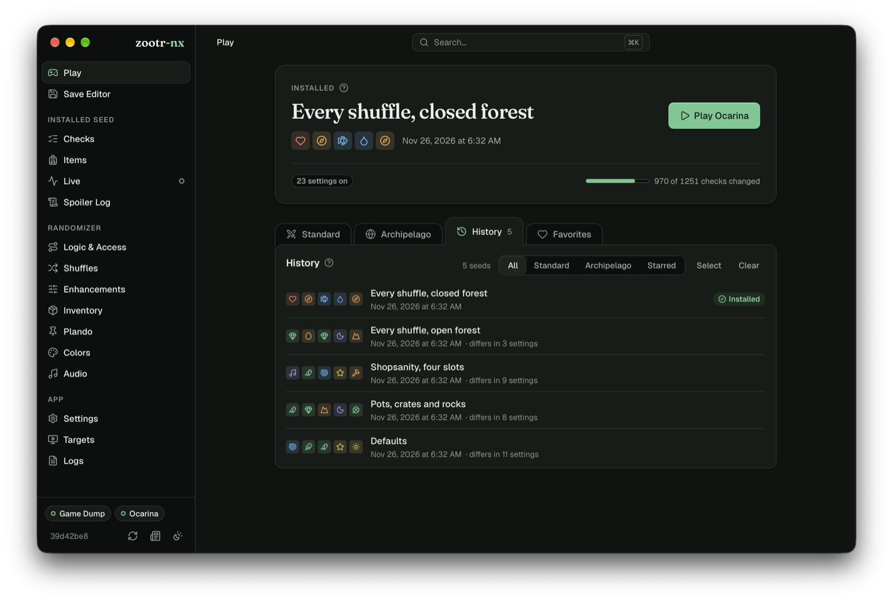
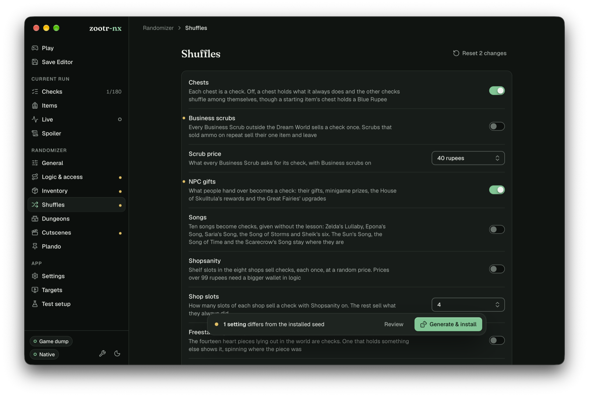
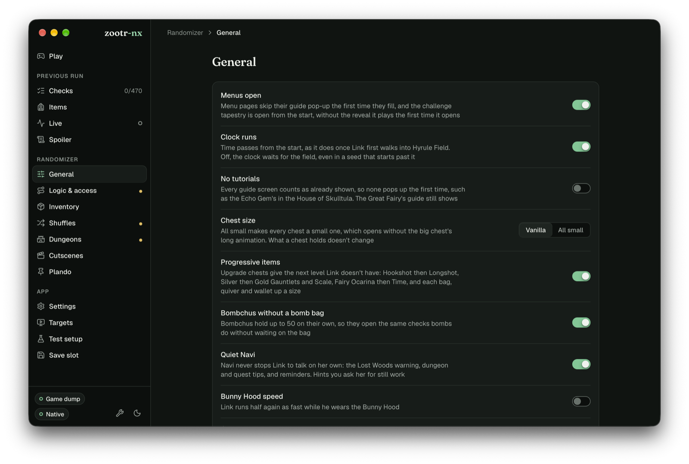
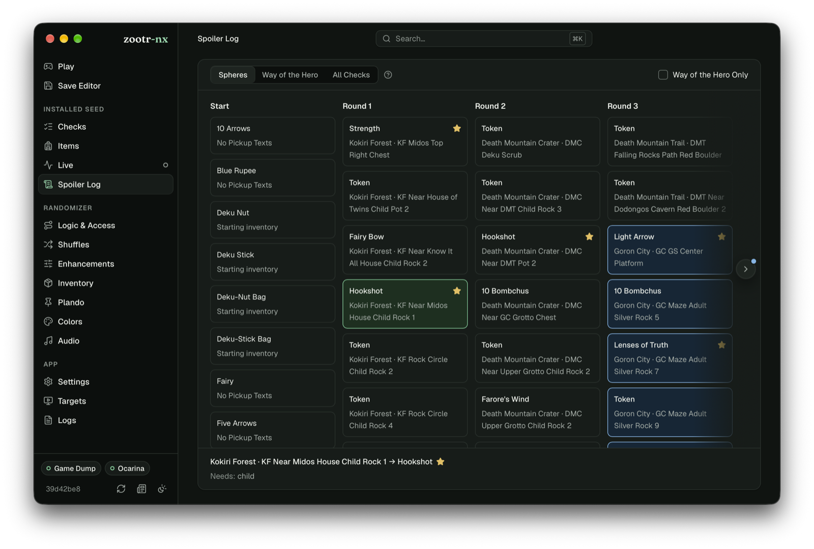
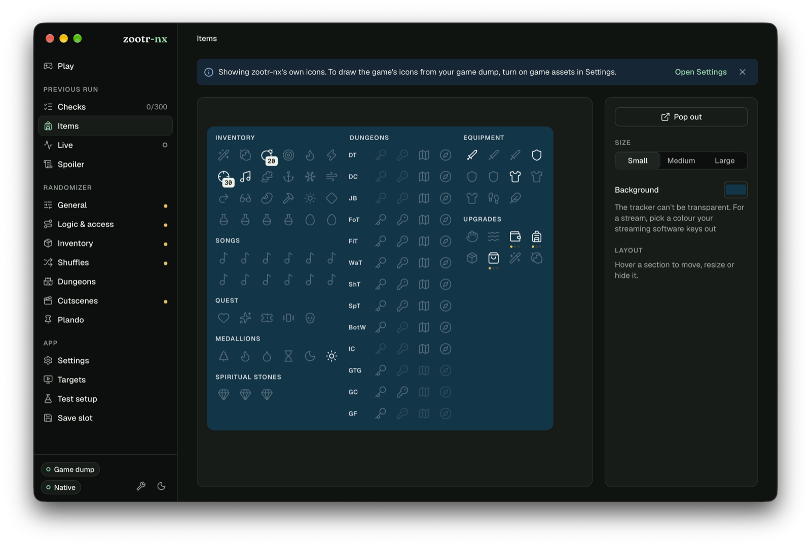
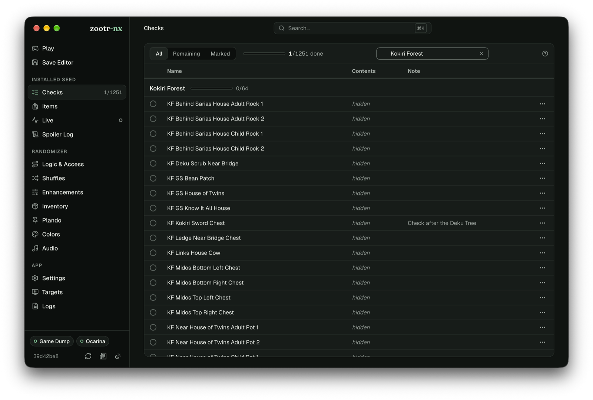
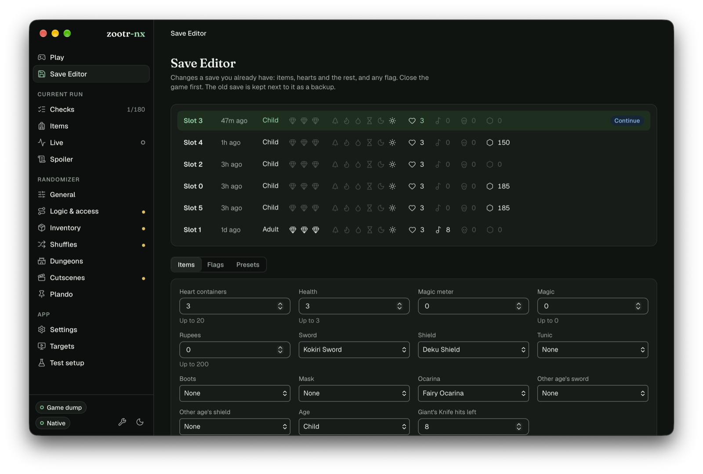
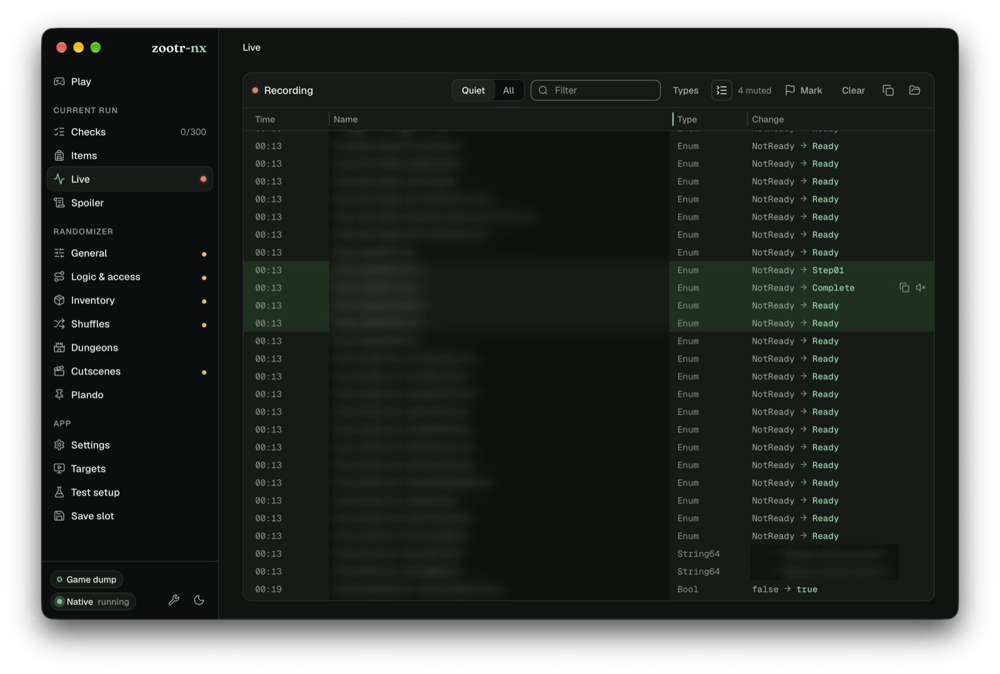

# zootr-nx

A randomizer for The Legend of Zelda: Ocarina of Time on Nintendo Switch 2.
It reads your own copy of the game, moves items to new places, and writes
the result as a mod.

## Read this first

- No piracy. zootr-nx contains no game files, code, text, art or audio. You
  need your own legally obtained copy of the game, dumped from your own
  console. zootr reads your dump at runtime and never distributes anything
  from it.
- No emulation help. The project doesn't provide, link to or support
  obtaining emulators, firmware, keys or game dumps, and won't answer
  questions about them. Issues and discussions asking for them get closed.
- Not affiliated with or endorsed by Nintendo or the Ocarina of Time
  Randomizer project.
  Nintendo, Nintendo Switch 2, The Legend of Zelda and Ocarina of Time are
  trademarks of Nintendo. All trademarks belong to their owners.

## Shuffle more than chests

Songs, NPC gifts, Business Scrubs, shops, cows, Gold Skulltulas, dungeon
rewards, boss hearts, even pots, crates, rocks and beehives. Each dungeon's
small keys can come as one key ring, shuffled with the boss keys. Glitchless
logic makes sure every seed can be beaten, and a share code passes a seed and
its settings to a friend.

## Custom models

A song placed in the world shows its own medallion, in the song's colour
with its icon on the face, where the game would show a rupee. Keys take
their dungeon's colour, so a key found far from home says where it belongs.
zootr builds each model from your dump when it writes a seed.

## Less waiting

Skip the cutscenes and tutorials, open every chest the quick way, and keep
Navi quiet unless you ask her.

## A spoiler that shows its working

Rounds lay out what Link can reach after each find. Pick a check to see
what it needs, and Way of the Hero stars everything Link can't finish
without. The installed seed's stays covered until you reveal it, so a
glance doesn't spoil the run.

## Track the run

The item tracker fills in as Link picks things up, and pops out into its
own window for OBS. It draws zootr-nx's own icons, or the game's from your
dump if you turn that on.

## Check off as you go

The checks list reads the running game and ticks each check off as Link
gets it, with nothing to click. What a check holds stays hidden until
then.

## Edit a save

The Save Editor changes a save you already have. Click an item to step it
up a tier, set hearts and rupees, or change any flag by name. Close the
game first. The old save stays beside the new one as a backup.

## Watch the game's flags

The Live log shows the game's values as they change, for working out what
a flag does.

## Get started

1. Download the app for your system from the
   [Releases page](https://github.com/TurtIeSocks/zootr-nx/releases).
2. Point it at your own dump of the game with the 1.1.1 update.
3. Add a target: the app that runs the game and the mod folder it loads.
4. Generate a seed and press Play.

From then on the app tells you when a new release is out, and installs it
when you click Install & restart.

The [guide](GUIDE.md) covers every feature, setting and target field, and
the CLI.

## Status

Early. Expect seeds that break and settings that change.

- zootr reads the 1.1.1 update of the game only.
- macOS is the main platform. Windows and Linux builds exist but are barely
  tested.
- The tracker, the Live log and the checks list read the running game.
  That works on macOS, and on Linux and Windows when the target has a
  `bridge`, a control socket its app opens for zootr.
- A setting the app marks Untested hasn't been played through yet.
- The logic is still primitive and needs more testing. A seed can still
  ask for something Link can't reach.

## Contributing

[CONTRIBUTING.md](CONTRIBUTING.md) has how to build from source and the
rules for pull requests.

## Licence

MIT. See `LICENSE`.
